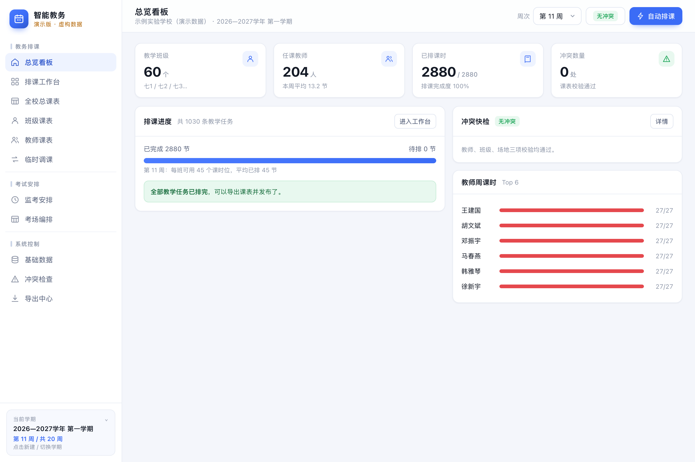
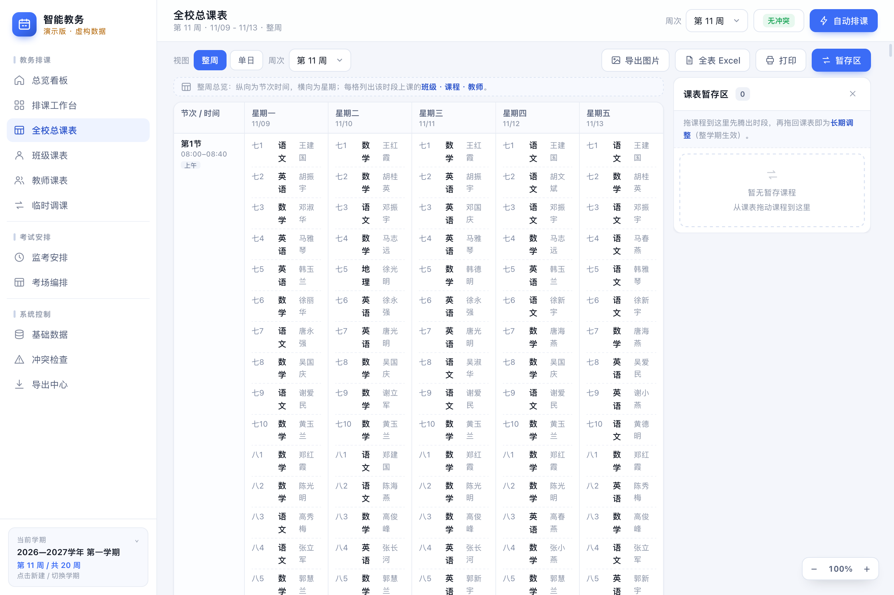
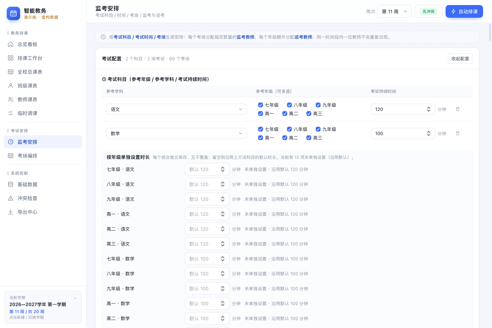
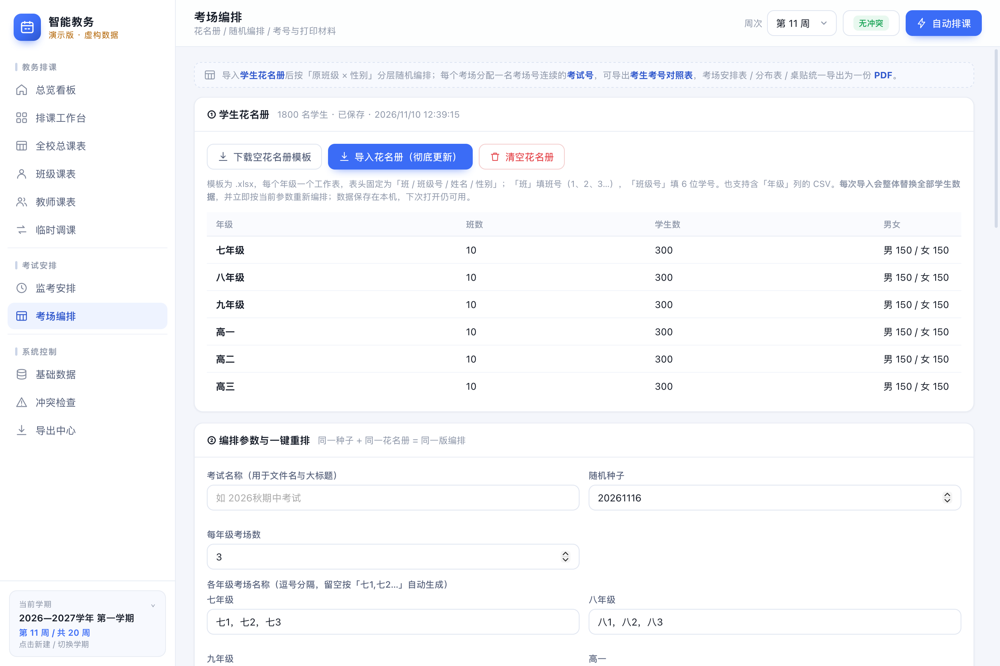

# 智能教务

本项目完全是用DeepSeek跑出来的，我本人对编程一窍不通，项目本意只是为了给我自己在工作中提供一些便捷，使用过程中出现的任何问题请自行负责，目前排课调课功能、考场编排和监考安排功能已基本可用，导出的表格是按我的需求设置的格式，可自行交给ai重新训练。下面的内容也都是DeepSeek写的。

一个**纯前端、单文件、可离线**的中小学教务工具：自动排课、监考安排、考场编排，以及与学校现有 Excel 模板对得上的各种导出。

- 网页部分是一个 `app.html`（约 1.4 MB），零外部依赖、零构建、双击即用；
- macOS 侧是一个 Swift 原生外壳（WKWebView），把「保存文件 / 打印 / 导出 PDF」这三件浏览器做不好的事接回系统；
- 数据存在**本机、且存在 App 包里**（`Contents/Resources/userdata/store.json`）：不联网、不上传、不需要账号，整个 App 拷到别的 Mac 上数据一起带走。详见 [docs/数据与迁移.md](docs/数据与迁移.md)。



## 能做什么

| 模块 | 能力 |
| --- | --- |
| 排课 | 按「班级 × 教师」任务表自动排课（贪心 + 多轮随机重启），支持单双周、连堂、教研活动禁排；冲突检查覆盖教师 / 班级 / 场地 |
| 课表 | 全校总课表、班级课表、教师课表、临时调课；课表可导出 PNG / XLSX / 打印，字形与分页全表统一 |
| 监考 | 按「科目 × 年级」配置考试与时长，一场可含多门科目；监考按工作量 → 同学科 → 随机种子分配，巡考强制取本年级本学科备课组长 / 学科组长，外教不排监考 |
| 考场 | 读 xlsx / csv 花名册，分层随机编排考场与座位，生成考号 `K+年级代码+考场+座位`；导出考号对照表（XLSX）与考场打印材料（名单 / 分布表 / 桌贴，一份 A4 黑白 PDF） |
| 数据 | 多学期切换、基础数据（年级 / 班级 / 教师 / 学科 / 场地 / 节次）、导入导出、冲突检查、导出中心 |

| 全校总课表 | 监考安排 | 考场编排 |
| --- | --- | --- |
|  |  |  |

> 仓库里的 `web/app.html` 内嵌了一套**虚构的演示数据**（6 个年级 × 10 个班 × 30 人、106 位教师、2880 节课），可以直接跑通所有功能。

## 快速开始

### 方式一：当网页用

```
open web/app.html
```

浏览器里除了「导出 PDF」之外的导出都会走下载；打印走浏览器打印对话框（选「存储为 PDF」同样可用）。

### 方式二：构建 macOS 应用

需要 Xcode Command Line Tools（`swiftc` / `codesign` / `plutil`）。

```bash
cd mac
./build.sh                      # 产物：../dist/智能教务.app
```

同一份源码可以打正式版和演示版（演示版用自己的 bundle id，数据仓库互不影响）：

```bash
APP_NAME="智能教务（演示）" BUNDLE_ID=com.zhipai.paike.demo ./build.sh
```

## 目录结构

```
web/app.html            整个网页应用：样式 + 数据层 + 视图层 + 交互层，单文件
mac/main.swift          原生外壳：窗口、桥接、保存面板、PDF / 打印
mac/Info.plist          App 元信息模板（build.sh 会按环境变量改写名称与 bundle id）
mac/build.sh            一键编译 + 打包 + ad-hoc 签名
tools/gen_demo_dataset.py  生成演示数据集（二分图边着色排满每班 45 节）
tools/demo_dataset.json    上面脚本的产物
tools/inject_dataset.py    把数据集注入 app.html（替换 `const DATASET` 那一行）
screenshots/            README 配图（--snapshot 生成）
docs/架构说明.md         数据模型、导出管线、PDF 分页几何等细节
docs/数据与迁移.md       数据仓库、拷贝迁移、签名封条、路径与权限边界
```

重造演示数据：

```bash
cd tools
python3 gen_demo_dataset.py demo_dataset.json     # 6 年级 × 10 班 × 30 人 / 2880 节课
python3 inject_dataset.py demo_dataset.json ../web/app.html
```

> 仓库里 `app.html` 内嵌的版本比脚本产物多一步：额外跑过「一键排考」和「一键考场编排」，所以打开就能直接看到监考表与考场材料。重新注入得到的是干净的空结果，功能一样，点一下生成即可。

`web/app.html` 内部按 5 段 `<script>` 组织，`grep` 这些标题即可定位：

| 段落 | 内容 |
| --- | --- |
| `const DATASET` | 演示数据集（正式使用时被 `userdata/store.json` 里的状态取代） |
| 数据层 | `DB` 状态模型、`normalizeState()` 自愈迁移、自动排课、冲突检查、多学期 |
| 导出 | `Export`：SVG 渲染器（PNG / 打印共用）、零依赖 XLSX、原生桥下载 |
| 视图层 | `VIEWS`：每个视图一个渲染函数，返回 `{title, sub, html}` |
| 交互层 | `ACT`：事件委托、拖拽换课、表单 `data-change` 处理 |

## 原生桥：五条命令

网页 → 原生（`window.webkit.messageHandlers.zhipai.postMessage`）：

| 命令 | 参数 | 原生行为 |
| --- | --- | --- |
| `state` | `term, week, weeks` | 把学期 / 周次写进窗口标题 |
| `vault` | `keys`（全量键值） | 合并后原子写入 App 包内的 `userdata/store.json` |
| `save` | `name, b64, path?` | 解码 base64 → 保存面板落盘（`path` 仅用于自动化测试） |
| `print` | `orientation?` | 取 `#printRoot` 内容 → 渲染成 A4 PDF → 系统打印对话框 |
| `pdf` | `name, html` | 离屏渲染独立 HTML → 逐页 `createPDF` → 保存面板 |

原生 → 网页（可选回调）：`window.__zhipaiPdfDone(result)`、`window.__zhipaiRefreshPrint()`。

网页只要发现 `window.__ZHIPAI_NATIVE__` 为真就走原生桥，否则退回浏览器的下载 / 打印——这也是同一份 HTML 既能当网页又能进 App 的原因。

### 数据为什么在 App 里，而不是 `~/Library`

`WKWebView` 的 localStorage 固定落在 `~/Library/WebKit/<bundle id>/`，没有公开 API 能改路径——放那儿拷 App 就是拷个空壳。所以原生外壳在 document start 注入一个 **localStorage 垫片**：读走内存快照（同步、语义不变），写经原生桥合并后落盘到包内的 `userdata/store.json`。网页代码一行没改。细节与迁移边界见 [docs/数据与迁移.md](docs/数据与迁移.md)。

### 为什么打印要「绕一圈」

`WKWebView` 会静默忽略 `window.print()`；而直接对它调 `printOperation`，在本机实测（macOS 15 / 26 均复现）会把页面当成无限长文档，一张两页的表格能吐出几百 MB、上千页。所以打印改成：

1. 从网页取出 `#printRoot` 的内容，并把 `@media print` 里的规则提到普通规则（离屏 WebView 按屏幕媒体渲染）；
2. 用和「导出 PDF」同一套离屏管线渲染成 A4 PDF；
3. 交给 `PDFDocument.printOperation(...)` 弹系统打印对话框。

顺带解决了分页质量：长表格按 `<tr>` 的位置换页，绝不把一行劈成两半。

## 自检钩子

```bash
BIN="dist/智能教务.app/Contents/MacOS/zhipai"

"$BIN" --selftest    # 桥接 / 原生标记 / localStorage / 首屏渲染 / 保存桥，结果写 /tmp/zhipai-selftest.log
"$BIN" --pdftest     # 真跑一遍考场编排 → 导出 PDF → /tmp/zhipai-pdf-test.pdf（附页数与首张纸尺寸）
"$BIN" --printtest   # 真跑一遍打印管线 → /tmp/zhipai-printcheck.pdf
"$BIN" --vaultinfo   # 数据仓库：位置 / 是否在包内 / 键数 → /tmp/zhipai-vault.log
"$BIN" --vaulttest   # 垫片生效 → 写标记 → 落盘 → 重载后数据仍在 → /tmp/zhipai-vaulttest-1.log、-2.log
"$BIN" --snapshot exam --shot /tmp/exam.png   # 切到指定视图截图
```

这些钩子跑的是真实链路（`--pdftest` 会真的排 1800 个座位、生成 186 页 PDF），适合改完代码后一把回归。

## 已知限制

- 只验证过 macOS 与浏览器；**没有**做 Windows / Linux 外壳（网页版在那边照常可用）。
- PDF / 打印的分页依赖网页里的纸面常量（A4 210×297mm，`html{zoom:.75}` 让 1 页 = 595.28×841.89 逻辑像素）。改这些常量时两边要一起改。
- 演示数据是虚构的；`tools/demo_dataset.json` 由脚本生成，改脚本即可重造。
- 构建出的是 ad-hoc 签名的 App，首次打开需要在「系统设置 → 隐私与安全性」里放行；要分发给别人需自备 Developer ID 证书。
- 二进制是 arm64 + x86_64 通用，最低系统 **macOS 13.0**（`build.sh` 里的 `DEPLOY_MIN`）。低于 13 的机器编译不出 x86_64 切片。
- 数据写在 App 包内会破坏代码签名封条，外壳会自动重签名（写后 20s 空闲 / 退出时 / 启动自检）。因此**拷贝前请先正常退出 App**，否则可能拷到封条失效的中间状态，在别的机器上被判「已损坏」。

## License

MIT，见 [LICENSE](LICENSE)。
